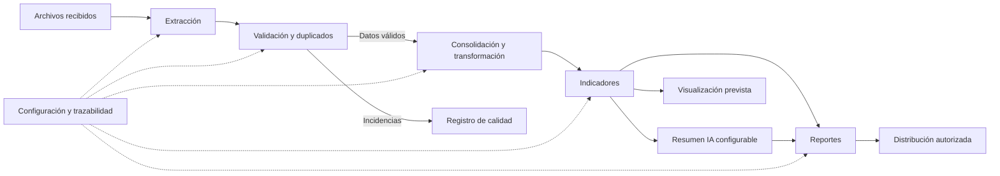
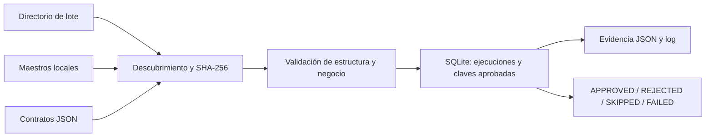

# Arquitectura preliminar

Propuesta conceptual sujeta a validación de fuentes, contratos, fórmulas y canales. Ningún componente del flujo está implementado en Fase 00.

Python y Pandas se proponen para procesamiento, OpenPyXL para archivos Excel y Streamlit para visualización. Power Automate se contempla como orquestador y canal potencial; IA y distribución requieren una decisión de diseño y autorización antes de conectar servicios. La ejecución debe preservar las fuentes, identificar insumos y ejecuciones, registrar incidencias y separar duración del robot de intervención humana. No se ha seleccionado proveedor de IA ni definido contratos de integración.

## Implementado en Fase 02

El CLI es independiente de interfaz y orquestador. SQLite serializa la comprobación y reserva de claves mediante transacción; el estado y las claves deben conservarse juntos. Los componentes posteriores del diagrama preliminar siguen sin implementar.

## Implementado en Fase 03

Validación → relectura y comparación de huellas → persistencia comercial transaccional en SQLite → lectura consistente → enriquecimiento por maestros conservando granularidades → indicadores → CSV/JSON con manifiesto. `runs.sqlite3` conserva validación; `commercial.sqlite3` conserva cinco tablas, llaves foráneas, trazabilidad por fila y metadatos de persistencia. La confirmación de validación no implica confirmación comercial.

El bloqueo de archivo del protocolo nuevo protege validación y recuperación en Windows. La recuperación solo modifica ejecuciones marcadas con ese protocolo y cuando obtiene el bloqueo; las ejecuciones antiguas sin marcador quedan intactas para revisión manual. El almacenamiento, los JSON locales y los originales deben respaldarse conjuntamente.

## Implementado en Fase 04

La ejecución estructurada de Fase 03 alimenta un lector de contratos y comprobaciones, seguido de generadores independientes OpenPyXL y ReportLab. Una carpeta temporal, verificación estructural, huellas y manifiesto preceden al renombrado final. La clave por contenido y formato permite omitir reejecuciones idénticas. No se integra ningún servicio externo y el pipeline anterior permanece independiente.

La clave de generación incorpora la versión centralizada y una huella SHA-256 de los módulos de `src/reporting/`, los recursos de sus directorios declarados y las versiones instaladas de las bibliotecas relevantes. Las rutas usadas en la huella son relativas y se excluyen las fechas de modificación. El manifiesto guarda versión y huella; los informes previos se conservan en sus directorios originales.
