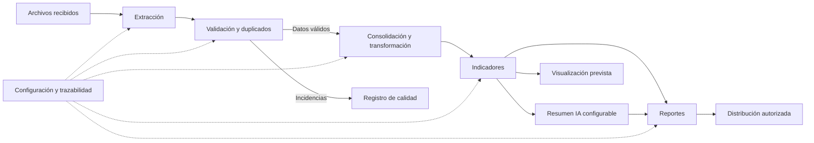
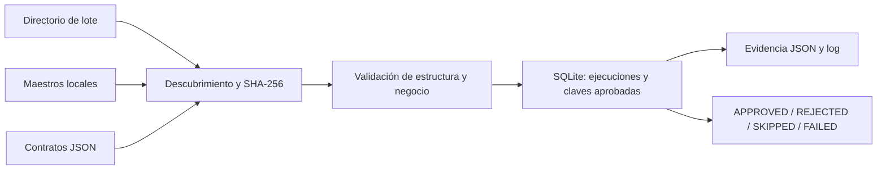

# Arquitectura preliminar

Fase 06 agrega una capa local: bandeja con marcador y huellas → pipeline existente → análisis local → informes enriquecidos verificados → borrador de distribución local. Un diario por contenido y bloqueo de espacio facilitan reintentos y evitan borradores repetidos; la cuarentena requiere una opción explícita.

Según la evidencia manual comunicada por el usuario, se creó el flujo **AutoReport360 - Procesamiento Comercial** en Power Automate Desktop, que invoca el motor Python. Se probaron SUCCESS, SKIPPED, REJECTED y FAILED, las notificaciones, la detención ante JSON inválido y una excepción controlada de PowerShell. No se ha implementado el envío real de correos. La plantilla del repositorio no puede declararse idéntica al bloque de PAD sin una exportación completa verificable. No se ha implementado automatización desatendida ni integración de Power Automate Cloud.

Fase 05.1 incorpora `src/ai_analysis/commercial_rules.py` como capa determinística sobre el catálogo y las fuentes validadas. La huella incluye sus módulos, configuración e instrucciones; el generador valida el contrato y enlaza su SHA-256. No hay conexiones reales ni decisiones automáticas.

Fase 05: un análisis de reglas consume la salida validada y produce hechos con evidencia; un proveedor inyectable selecciona únicamente IDs existentes. Los informes reciben opcionalmente ese JSON y validan su vínculo con el origen. La CLI mantiene deshabilitado el acceso externo y usa contingencia local ante fallo.

La siguiente propuesta conceptual describe el estado histórico de la Fase 00, antes de implementar los componentes indicados en las secciones posteriores.

En la propuesta inicial se contemplaban Python y Pandas para procesamiento, OpenPyXL para Excel, Streamlit para visualización y Power Automate para orquestación. El estado implementado se describe en las secciones de cada fase. Las conexiones reales de IA y la distribución requieren autorización; la ejecución debe preservar las fuentes, registrar incidencias y separar duración del robot de intervención humana.

## Implementado en Fase 02

El CLI es independiente de interfaz y orquestador. SQLite serializa la comprobación y reserva de claves mediante transacción; el estado y las claves deben conservarse juntos. Los componentes posteriores del diagrama preliminar siguen sin implementar.

## Implementado en Fase 03

Validación → relectura y comparación de huellas → persistencia comercial transaccional en SQLite → lectura consistente → enriquecimiento por maestros conservando granularidades → indicadores → CSV/JSON con manifiesto. `runs.sqlite3` conserva validación; `commercial.sqlite3` conserva cinco tablas, llaves foráneas, trazabilidad por fila y metadatos de persistencia. La confirmación de validación no implica confirmación comercial.

El bloqueo de archivo del protocolo nuevo protege validación y recuperación en Windows. La recuperación solo modifica ejecuciones marcadas con ese protocolo y cuando obtiene el bloqueo; las ejecuciones antiguas sin marcador quedan intactas para revisión manual. El almacenamiento, los JSON locales y los originales deben respaldarse conjuntamente.

## Implementado en Fase 04

La ejecución estructurada de Fase 03 alimenta un lector de contratos y comprobaciones, seguido de generadores independientes OpenPyXL y ReportLab. Una carpeta temporal, verificación estructural, huellas y manifiesto preceden al renombrado final. La clave por contenido y formato permite omitir reejecuciones idénticas. No se integra ningún servicio externo y el pipeline anterior permanece independiente.

La clave de generación incorpora la versión centralizada y una huella SHA-256 de los módulos de `src/reporting/`, los recursos de sus directorios declarados y las versiones instaladas de las bibliotecas relevantes. Las rutas usadas en la huella son relativas y se excluyen las fechas de modificación. El manifiesto guarda versión y huella; los informes previos se conservan en sus directorios originales.
